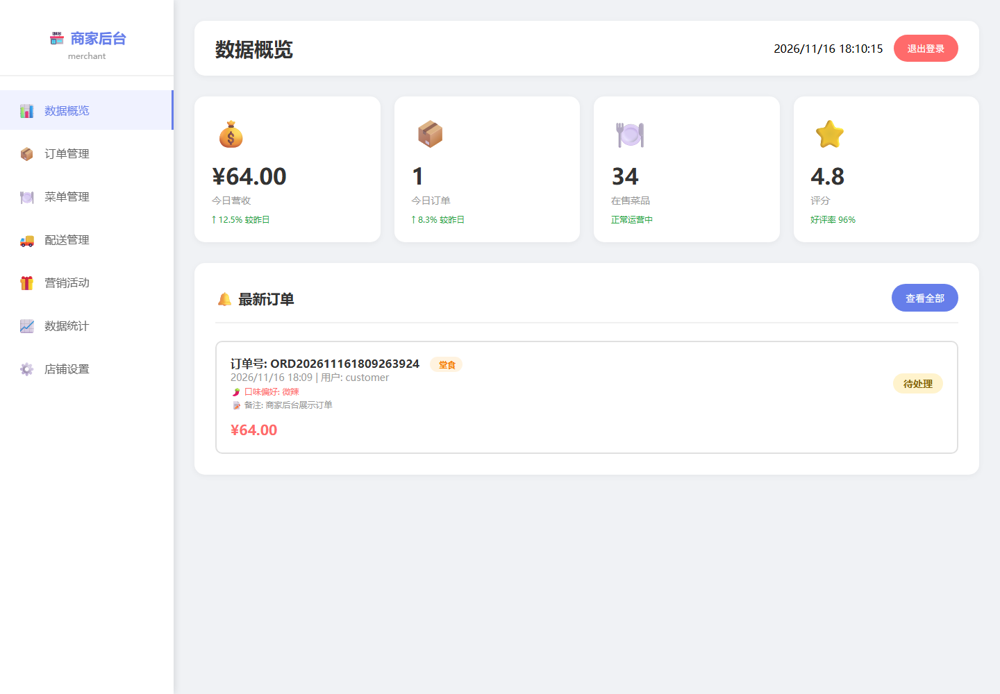
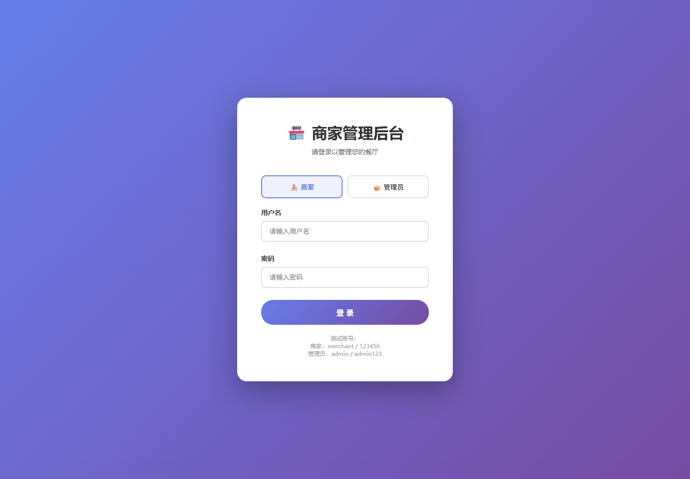
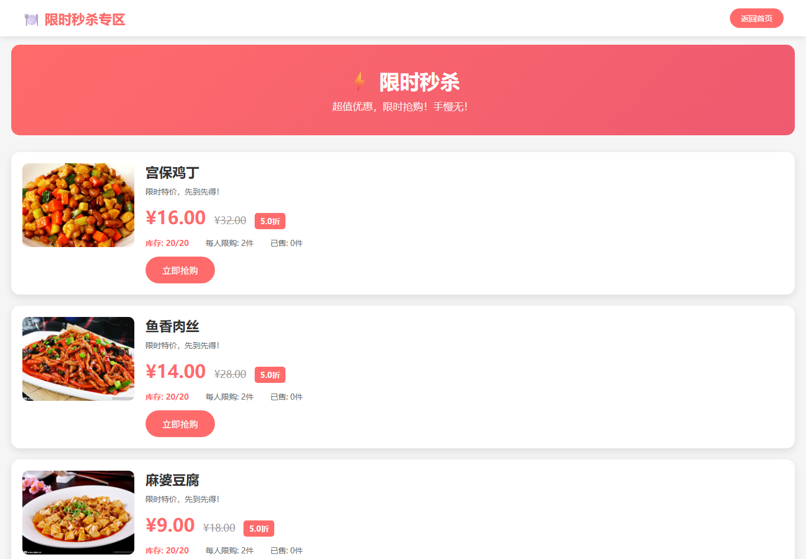

# 在线订餐系统

[](https://github.com/Nian198-wq/online-food-ordering/actions/workflows/ci.yml)
[](https://www.java.com/)
[](https://spring.io/projects/spring-boot)
[](LICENSE)

基于 Spring Boot、Spring Data JPA 和 H2/MySQL 的前后端一体化订餐系统。项目覆盖顾客点餐、商家订单处理、菜品管理、支付记录、配送和统计等流程，适合作为 Java 后端实习项目展示。

## 界面预览




<details>
<summary>查看商家端登录页</summary>



</details>



更多模块关系和下单流程见 [架构设计](docs/architecture.md)。

## 功能

- 顾客端：菜品浏览、分类筛选、搜索、购物车、下单、支付和订单跟踪
- 商家端：订单状态处理、菜品与库存管理、配送管理、经营统计
- 营销模块：限时秒杀活动与活动库存
- 接口层：30 余个 RESTful API，统一参数校验和异常响应
- 数据层：Spring Data JPA、H2 内存数据库、MySQL 运行配置

## 核心设计

### 1. 下单与库存事务

订单和库存扣减位于同一个数据库事务中。每个菜品通过带库存条件的原子 SQL 更新扣减库存：

```sql
UPDATE dishes
SET stock = stock - :quantity
WHERE id = :dishId
  AND available = true
  AND stock >= :quantity;
```

更新行数为 0 时立即报错并回滚整个订单，避免并发请求导致超卖或产生半成品订单。

### 2. 提交幂等

前端为每次结算生成 `clientRequestId`，数据库对订单请求号建立唯一约束。相同请求重复提交时返回已有订单，不重复扣减库存。

### 3. 订单状态机

```text
PENDING -> CONFIRMED -> PREPARING -> DELIVERING -> COMPLETED
    |          |            |
    +----------+------------+----> CANCELLED
```

服务层会校验状态流转。取消订单时回补库存；已支付订单同时将支付状态标记为 `REFUNDED`。

### 4. 库存显示

顾客端展示实时库存并限制购物车数量，商家端可以维护菜品库存。库存为 0 时前端显示“已售罄”。

## 技术栈

- Java 11
- Spring Boot 2.6.13
- Spring MVC、Spring Data JPA、Bean Validation
- H2、MySQL
- Maven
- HTML5、CSS3、原生 JavaScript

## 项目结构

```text
src/main/java/com/niit/guanlixiyong/
  controller/   REST API
  service/      订单、菜品、库存与统计业务
  repository/   JPA 数据访问
  entity/       数据库实体
  dto/          请求与响应模型
  config/       数据初始化
src/main/resources/
  static/       顾客端、商家端和秒杀页面
  application.properties
src/test/java/
  service/      订单事务、幂等和并发库存测试
```

## 启动

环境要求：JDK 11 或更高版本、Maven 3.8+。

```bash
mvn spring-boot:run
```

访问地址：

- 顾客端：<http://localhost:8080>
- 商家端：<http://localhost:8080/merchant.html>
- H2 控制台：<http://localhost:8080/h2-console>

测试账号：

| 角色 | 用户名 | 密码 |
|---|---|---|
| 顾客 | customer | 123456 |
| 商家 | merchant | 123456 |
| 管理员 | admin | admin123 |
| 配送员 | delivery | 123456 |

## 下单接口示例

```http
POST /api/orders
Content-Type: application/json

{
  "userId": 3,
  "clientRequestId": "8c8d8a90-2a7e-4d4d-a7ae-25de65b43a4e",
  "orderType": "DINE_IN",
  "deliveryAddress": "",
  "deliveryPhone": "13900000001",
  "items": [
    {
      "dishesId": 1,
      "quantity": 2
    }
  ]
}
```

## 测试

```bash
mvn clean test
```

GitHub Actions 会在每次推送和 Pull Request 时自动运行同一套测试。

当前测试结果：共 6 个测试全部通过，其中包含 5 个订单工作流集成测试：

- 正常下单与库存扣减
- 库存不足时事务回滚
- 相同请求号幂等提交
- 取消订单回补库存
- 非法状态流转拦截
- 12 个并发请求下库存 5 件不超卖

## 已知限制

- 支付为演示实现，不会调用真实支付平台
- 配送采用轮询刷新，尚未接入 WebSocket 推送
- H2 数据在应用重启后清空，切换 MySQL 后可持久化

## 许可证

本项目使用 [MIT License](LICENSE)。
