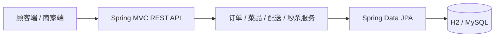
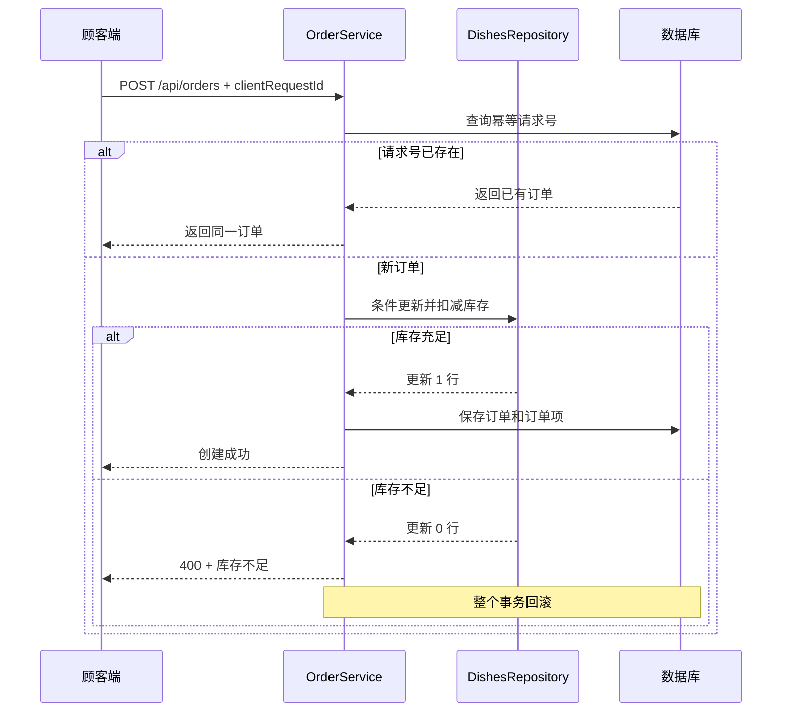
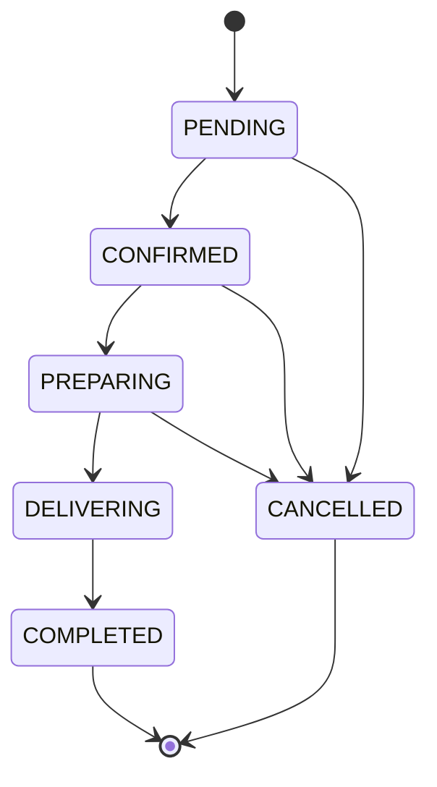

# 系统架构

## 分层结构

## 下单流程

## 订单状态机

取消订单会原子回补库存，已支付订单同时标记为 `REFUNDED`。非法状态跳转会被服务层拒绝。

## 一致性设计

- 库存扣减和订单写入使用同一个事务。
- 库存更新包含 `stock >= quantity` 条件，避免并发超卖。
- `clientRequestId` 在数据库层唯一，防止重复提交。
- 单元与集成测试覆盖库存不足回滚、幂等和 12 个并发下单请求。
